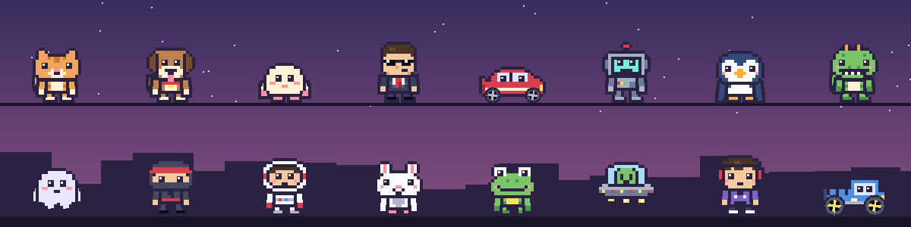
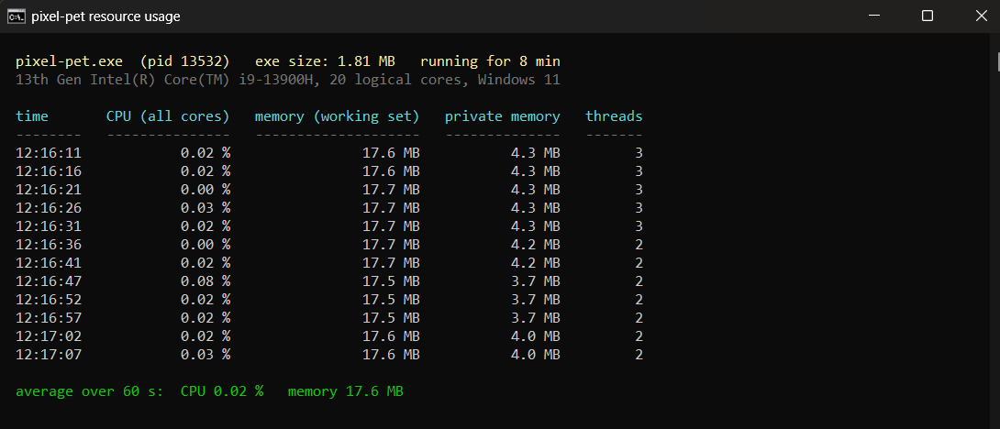

# Pixel Pet

A tiny pixel pet that lives on your Windows desktop and keeps you on task.
Free and open source. One 1.8 MB exe, no installer, no account, no telemetry.


**[Download for Windows](https://github.com/Shreeniwas1/pixel-pet/releases/latest)** · [Website](https://pixel-pet.pages.dev) · [Demo video](media/pixel-pet-demo.mp4)

## What it does

- **Smart tasks.** Type like you talk: `call mom tomorrow 5pm`, `stretch in 45m`, `standup weekdays 9:30`, `team sync every monday 10am`.
- **Focus timer.** Pomodoro presets, a daily goal, streaks and a weekly recap.
- **Network speed.** Live download and upload speed in a bubble beside the pet, plus CPU and memory if you like.
- **AI token counter.** Today's and the last 7 days' tokens from Claude Code, Codex and OpenCode, read from the logs already on your PC.
- **A live pet.** It walks around on its own legs (or wheels), does random tricks, gets hungry, and dozes off when nobody touches it.
- **Hands on.** Stroke it, click to hit it (it goes dizzy, then flies), pull it until it stretches, pick it up and throw it.
- **Feed it.** Pizza and coffee for people, fish for the cat, fuel and nitro for the car. Coffee and nitro make it run.
- **Quick tools.** A calculator, five pages of notes saved as you type, VS Code, and a quick launch list of your own apps, folders and links (drop them on the pet).
- **Coding buddy.** Types along when you do, thinks while Claude Code works, and tells you when it is done or asks something. It never sees what you type.
- **Plays with you.** Throw the ball and it fetches. Give it a friend and they visit, dance and chase each other.
- **Levels and hats.** Looking after it earns experience; levels unlock hats.
- **Knows your PC.** Sweats under load, droops when the battery is low, perks up when plugged in.
- **Walks on your windows** if you let it: climbs up, rides along, and falls when you close one.
- **Dances to your music.** It reads Windows' loudness meters (never the sound itself) and moves on the beat. The hub shows what is playing, with play, pause and skip.
- **Walks to your other monitors.** Side by side or stacked, landscape or portrait: it walks across, climbs stairs or a ladder, jumps off the edge or floats down under an umbrella.
- **Shows what you choose.** Right-click, **Show**, and tick what you want to see; untick everything for just the pet.
- **Gets out of the way.** Hides for fullscreen apps, games, film players, streaming sites and any program you add, never steals focus. Always-on-top and click-through are up to you.
- **Minimal mode.** A half-size pet that keeps quiet and only speaks up for your reminders and focus timer; hover for the numbers.
- **Tray icon.** Hover for network, CPU and memory; click to hide or show the pet, right-click for the hub.
- **Sixteen pets, five themes.** Cat, Dog, Mochi, Agent, Super Car, Robot, Penguin, Dino, Ghost, Ninja, Astronaut, Bunny, Frog, UFO, Coder, Truck; Night, Ocean, Forest, Candy, Mono.
- **As lively as you like.** Walking, random tricks, gravity, sounds, what a left click does and when it falls asleep are all options.

| Tasks | Stats | Hub |
|---|---|---|
|  |  |  |




## Footprint

Measured on Windows 11 (Core i9-13900H), pet idle with the info bubble on, sampled for a minute:

| | |
|---|---|
| Download | 1.8 MB, a single exe |
| Memory | about 17.6 MB working set (4 MB private) |
| CPU | about 0.02% |

Those numbers are from before the pets could move. On another PC an animated pet takes about 0.6% of one CPU core
standing and 2% walking and playing; a friend doubles that. The exe is 2.5 MB.



## Install

1. Download the zip from [Releases](https://github.com/Shreeniwas1/pixel-pet/releases/latest) and unzip it anywhere.
2. Run `pixel-pet.exe`. The pet appears in the bottom-right corner and introduces itself.

The app is not code-signed yet, so Windows SmartScreen may warn on first run: choose **More info**, then **Run anyway**.

To uninstall, close the pet, delete the exe and the files starting with `pixel-pet` in `%APPDATA%`.

## Hotkeys

All of them can be changed under **Options > Windows > Shortcut keys**.

| Keys | Action |
|---|---|
| `Ctrl+Alt+T` | add a task |
| `Ctrl+Alt+F` | toggle focus mode |
| `Ctrl+Alt+S` | open the stats window |
| `Ctrl+Alt+M` | toggle minimal mode |
| `Ctrl+Alt+H` | hide or show the pet |
| `Ctrl+Alt+P` | open the pet hub (or right-click the pet) |
| `Ctrl+Alt+E` | feed the pet its favourite |
| `Ctrl+Alt+K` | calculator |
| `Ctrl+Alt+N` | notes |
| `Ctrl+Alt+D` | open VS Code |
| `Ctrl+Alt+Q` | close the pet; with **Options > Windows > Ctrl+Alt+Q opens me too**, also start it |

## Privacy

Everything stays on your PC. There is no account and no telemetry, and the app makes no network
connections: the speed bubble only reads Windows' own traffic counters. The coding buddy reads Claude Code's log on
your PC to see who spoke last, window titles are only compared with a list of film sites, and links in your quick
launch open in your own browser. Settings and data live in
`%APPDATA%`.

## Build from source

Needs [Rust](https://rustup.rs) on Windows.

```
cargo test
cargo build --release
```

`scripts\package.ps1` runs the tests, builds the release exe and zips it into `dist\`.

The code is plain Win32 and GDI with two dependencies (`windows-sys`, `ruzstd`). Start at `src/main.rs`;
pets are small pixel grids in `src/cast.rs`, their movements are in `src/anim.rs`, their food in `src/food.rs` and
their hats in `src/wardrobe.rs`, so a new pet, trick, snack or hat is a good first contribution. `PET_SHEET=folder cargo test contact_sheet -- --ignored` draws them all.

## Licence

Code: [GPL-3.0-or-later](LICENSE). Pixel art: [CC BY 4.0](LICENSE-ART.md). Third-party notices: [NOTICE.md](NOTICE.md).
