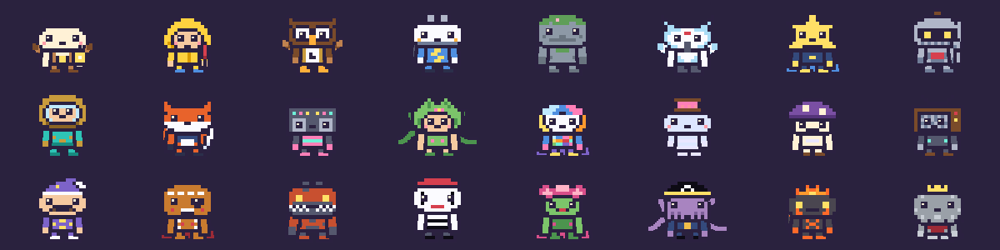
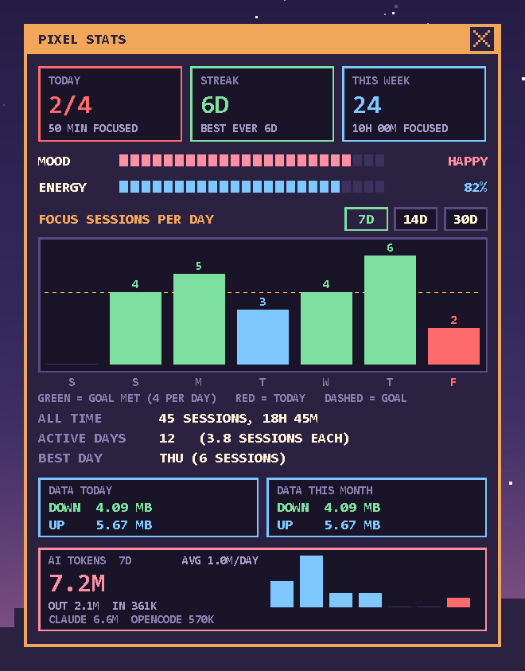
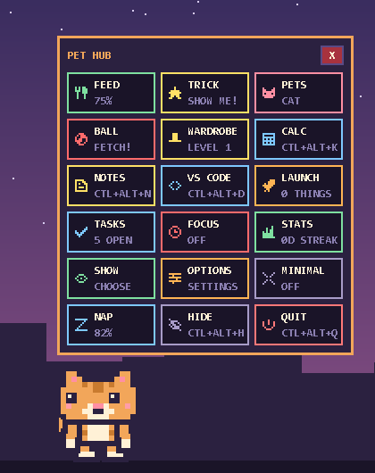

# Pixel Pet

A tiny pixel pet that lives on your Windows desktop and keeps you on task.
Free and open source. One 1.8 MB exe, no installer, no account, no telemetry.


**[Download for Windows](https://github.com/Shreeniwas1/pixel-pet/releases/latest)** · [Website](https://pixel-pet.pages.dev) · [Demo video](media/pixel-pet-demo.mp4)

## What it does

- **Smart tasks.** Type like you talk: `call mom tomorrow 5pm`, `stretch in 45m`, `standup weekdays 9:30`, `team sync every monday 10am`.
- **Focus timer.** Pomodoro presets, a daily goal, streaks and a weekly recap. The stats show your best time of day to focus and how many rounds you saw through.
- **Do not disturb.** For half an hour, an hour, two, or until the morning, and by itself in focus rounds and meetings: the pet keeps its own words for later, and your tasks and meetings still come.
- **Network speed.** Live download and upload speed in a bubble beside the pet, plus CPU and memory if you like.
- **Calendar reminders.** Add a calendar file, or the private link of Google Calendar or Outlook, and it tells you before things start.
- **Breaks.** Water, eyes, standing up and posture, each with its own time, and a counted-down rest for the eyes. Never in a focus round.
- **Build watcher.** Cheers when GitHub Actions pass and reels when they fail. Your own scripts can tell it too: `pixel-pet --tell pass my tests`.
- **Downloads and copies.** Cheers when a big download lands in your Downloads folder, and on Windows when a copy of files is done.
- **AI token counter.** Today's and the last 7 days' tokens from Claude Code, Codex and OpenCode, read from the logs already on your PC.
- **A live pet.** It walks around on its own legs (or wheels), does random tricks, gets hungry, and dozes off when nobody touches it.
- **Hands on.** Stroke it, click to hit it (it goes dizzy, then flies), pull it until it stretches, pick it up and throw it.
- **Feed it.** Pizza and coffee for people, fish for the cat, fuel and nitro for the car. Coffee and nitro make it run.
- **Quick tools.** A calculator, five pages of notes saved as you type, clipboard history (in memory only, off until you switch it on), VS Code, and a quick launch list of your own apps, folders and links (drop them on the pet).
- **Coding buddy.** Types along when you do, thinks while Claude Code works, and tells you when it is done or asks something. It never sees what you type.
- **Plays with you.** Throw the ball and it fetches. Give it a friend and they visit, dance and chase each other.
- **Levels and hats.** Looking after it earns experience; levels unlock hats.
- **Day and night, and the seasons.** It yawns in the evening and sleeps in a nightcap at night. Snow, leaves, petals or fireflies drift past now and then, and it wears a scarf in winter. A party hat on your birthday, its own birthday and New Year, a witch hat on Halloween. The south of the world gets its own seasons.
- **A garden and a room.** Three pots: water them once a day and a seed flowers on the fourth. Picked flowers go on the shelf in the pet's room, whose window shows the time of day and the season; a rug, a lamp, books and a picture come with the levels.
- **Knows your PC.** Sweats under load, droops when the battery is low, perks up when plugged in.
- **Walks on your windows** if you let it: climbs up, rides along, and falls when you close one.
- **Dances to your music.** On Windows it reads the loudness meters (never the sound itself) and moves on the beat; on Linux and macOS it knows that a player plays. The hub shows what is playing, with play, pause and skip.
- **Walks to your other monitors.** Side by side or stacked, landscape or portrait: it walks across, climbs stairs or a ladder, jumps off the edge or floats down under an umbrella. Heroes need none of that: they fly, leap, swing, reel themselves up or step through a portal.
- **Shows what you choose.** Right-click, **Show**, and tick what you want to see; untick everything for just the pet.
- **Gets out of the way.** Hides for fullscreen apps, games, film players, streaming sites and any program you add, never steals focus. Always-on-top and click-through are up to you.
- **Minimal mode.** A half-size pet that keeps quiet and only speaks up for your reminders and focus timer; hover for the numbers.
- **Tray icon.** Hover for network, CPU and memory; click to hide or show the pet, right-click for the hub.
- **Forty pets and five themes.** Cat, Dog, Mochi, Agent, Super Car, Robot, Penguin, Dino, Ghost, Ninja, Astronaut, Bunny, Frog, UFO, Coder, Truck; Night, Ocean, Forest, Candy, Mono.
- **Heroes and villains of our own.** Twenty-four of them, each with powers: Lampmoth, Puddlejack, Clockowl, Kettlewick, Spindle the silkworm, Gloomcap, Baron Crumb, Lady Bramble and more. Anybody with powers saves themselves from a fall.
- **Character maker.** Draw a pet, choose its power, tricks and voice, and have it. It is kept as a pack you can give away.
- **Character packs.** Get more from the gallery, or import a `.petpack` file and its characters, with their own moves and lines, are in the picker. It is a text file you can write yourself: [how to](docs/PACKS.md).
- **As lively as you like.** Walking, random tricks, gravity, sounds, what a left click does and when it falls asleep are all options.



| Tasks | Stats | Hub |
|---|---|---|
|  |  |  |


## Footprint

Measured on Windows 11 (Core i9-13900H), pet idle with the info bubble on, sampled for a minute:

| | |
|---|---|
| Download | 1.8 MB, a single exe |
| Memory | about 17.6 MB working set (4 MB private) |
| CPU | about 0.02% |

Those numbers are from before the pets could move. On another PC an animated pet takes about 0.6% of one CPU core
standing and 2% walking and playing; a friend doubles that. Heroes showing off their powers take about 2.6%. The exe is 2.9 MB.


## Install

1. Download the zip from [Releases](https://github.com/Shreeniwas1/pixel-pet/releases/latest) and unzip it anywhere.
2. Run `pixel-pet.exe`. The pet appears in the bottom-right corner and introduces itself.

The app is not code-signed yet, so Windows SmartScreen may warn on first run: choose **More info**, then **Run anyway**.

To uninstall, close the pet, delete the exe and the files starting with `pixel-pet` in `%APPDATA%`.

### Linux

Unpack the `.tar.gz` and run `./pixel-pet`, or `./install.sh` to put it into your applications menu. It is one
file that runs on any distribution. It needs an X server; Wayland desktops run it through XWayland, where it
only sees windows that run there too.

### macOS

Unzip and move **Pixel Pet** to Applications. It lives in the menu bar and has no Dock icon. Where the shortcuts
below say Alt, a Mac has **Option**. A copy that is not signed with a Developer ID has to be allowed once, under
**System Settings > Privacy & Security > Open Anyway**.

On macOS what is playing comes from Music and Spotify, and macOS asks once before the pet may pause them. On Linux it
comes from any player that speaks MPRIS, and the tray icon needs a tray that speaks StatusNotifierItem (KDE does,
GNOME with an extension). Not on Linux and macOS yet: OpenCode's tokens.

## Hotkeys

All of them can be changed under **Settings > Keys and startup > Shortcut keys**.

| Keys | Action |
|---|---|
| `Ctrl+Alt+T` | add a task |
| `Ctrl+Alt+F` | toggle focus mode |
| `Ctrl+Alt+S` | open the stats window |
| `Ctrl+Alt+M` | toggle minimal mode |
| `Ctrl+Alt+H` | hide or show the pet |
| `Ctrl+Alt+P` | open the pet hub (or right-click the pet) |
| `Ctrl+Alt+E` | feed the pet its favourite |
| `Ctrl+Alt+K` | calculator |
| `Ctrl+Alt+N` | notes |
| `Ctrl+Alt+D` | open VS Code |
| `Ctrl+Alt+V` | clipboard history |
| `Ctrl+Alt+Q` | close the pet; with **Settings > Keys and startup > Ctrl+Alt+Q opens me too**, also start it |

## Privacy

Everything stays on your PC. There is no account and no telemetry. The speed bubble only reads your system's own
traffic counters, the coding buddy reads Claude Code's log on your PC to see who spoke last, window titles are only
compared with a list of film sites, and links in your quick launch open in your own browser. The clipboard history is
off until you switch it on, is only ever in memory, and leaves out what password managers mark as secret. For downloads
it only looks at the names and sizes in your Downloads folder, and for copies at the title of Windows' copy window.
Your birthday, if you give it, is kept with the other settings.

The app asks the internet for these things, and only these:

| What | When | Who is asked |
|---|---|---|
| Newer versions | once a day, if you said yes; or **Look now** | GitHub |
| Pack gallery | when you open its page | GitHub |
| Build watcher | while you watch a repository | GitHub, with your token if you gave one |
| Calendar links | every 15 minutes, if you added one | the address of that link |

Nothing about you or your PC is sent along. Calendar links and the GitHub token are locked with your Windows account, or
kept in the macOS keychain or the Linux keyring (in a file only you can read if there is none). Settings and data live in
`%APPDATA%` (`~/.config/pixel-pet` on Linux, `~/Library/Application Support/Pixel Pet` on macOS).

## Build from source

Needs [Rust](https://rustup.rs). On Linux and macOS `src/port/` answers the Windows calls the rest is written
against; `scripts/package-linux.sh` and `scripts/package-macos.sh` make the packages.

```
cargo test
cargo build --release
```

`scripts\package.ps1` runs the tests, builds the release exe and zips it into `dist\`.

The code is plain Win32 and GDI with two dependencies (`windows-sys`, `ruzstd`). Start at `src/main.rs`;
pets are small pixel grids in `src/cast.rs` (the heroes are a pack, `assets/heroes.petpack`, read by `src/pack.rs`; powers are in `src/powers.rs`), their movements are in `src/anim.rs`, their food in `src/food.rs` and
their hats in `src/wardrobe.rs`, so a new pet, trick, snack or hat is a good first contribution. `PET_SHEET=folder cargo test contact_sheet -- --ignored` draws them all.

## Licence

Code: [GPL-3.0-or-later](LICENSE). Pixel art: [CC BY 4.0](LICENSE-ART.md). Third-party notices: [NOTICE.md](NOTICE.md).
