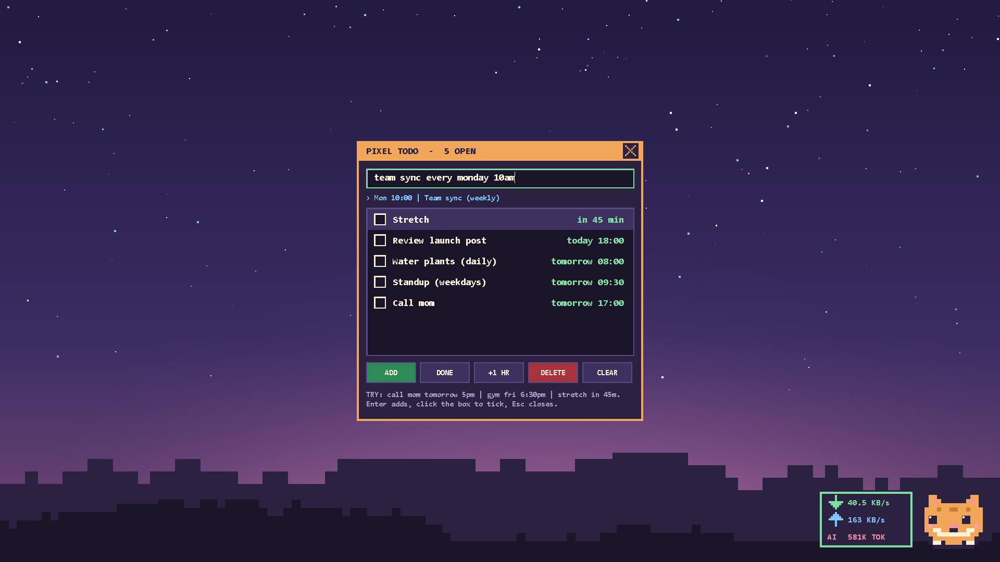
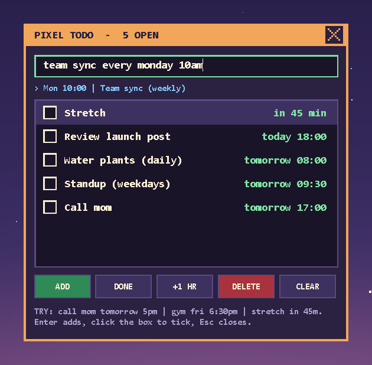
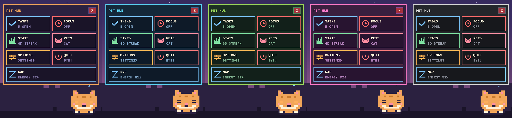

# Pixel Pet

A tiny pixel pet that lives on your Windows desktop and keeps you on task.
Free and open source. One 1.8 MB exe, no installer, no account, no telemetry.



**[Download for Windows](https://github.com/Shreeniwas1/pixel-pet/releases/latest)** · [Website](https://pixel-pet.pages.dev) · [Demo video](media/pixel-pet-demo.mp4)

## What it does

- **Smart tasks.** Type like you talk: `call mom tomorrow 5pm`, `stretch in 45m`, `standup weekdays 9:30`, `team sync every monday 10am`.
- **Focus timer.** Pomodoro presets, a daily goal, streaks and a weekly recap.
- **Network speed.** Live download and upload speed in a bubble beside the pet.
- **AI token counter.** Today's and the last 7 days' tokens from Claude Code, Codex and OpenCode, read from the logs already on your PC.
- **A pet with moods.** It stretches in the morning, naps when idle, sleeps at night and likes being stroked.
- **Gets out of the way.** Hides behind fullscreen games and video, never steals focus.
- **Five pets, five themes.** Cat, Dog, Mochi, Agent, Super Car; Night, Ocean, Forest, Candy, Mono.

| Tasks | Stats | Hub |
|---|---|---|
|  |  |  |



## Footprint

Measured on Windows 11 (Core i9-13900H), pet idle with the info bubble on, sampled for a minute:

| | |
|---|---|
| Download | 1.8 MB, a single exe |
| Memory | about 17.6 MB working set (4 MB private) |
| CPU | about 0.02% |


## Install

1. Download the zip from [Releases](https://github.com/Shreeniwas1/pixel-pet/releases/latest) and unzip it anywhere.
2. Run `pixel-pet.exe`. The pet appears in the bottom-right corner and introduces itself.

The app is not code-signed yet, so Windows SmartScreen may warn on first run: choose **More info**, then **Run anyway**.

To uninstall, close the pet, delete the exe and the files starting with `pixel-pet` in `%APPDATA%`.

## Hotkeys

| Keys | Action |
|---|---|
| `Ctrl+Alt+T` | add a task |
| `Ctrl+Alt+F` | toggle focus mode |
| `Ctrl+Alt+S` | open the stats window |

## Privacy

Everything stays on your PC. There is no account and no telemetry, and the app makes no network
connections: the speed bubble only reads Windows' own traffic counters. Settings and data live in
`%APPDATA%`.

## Build from source

Needs [Rust](https://rustup.rs) on Windows.

```
cargo test
cargo build --release
```

`scripts\package.ps1` runs the tests, builds the release exe and zips it into `dist\`.

The code is plain Win32 and GDI with two dependencies (`windows-sys`, `ruzstd`). Start at `src/main.rs`;
pets are small pixel grids in `src/art.rs`, so a new pet is a good first contribution.

## Licence

Code: [GPL-3.0-or-later](LICENSE). Pixel art: [CC BY 4.0](LICENSE-ART.md). Third-party notices: [NOTICE.md](NOTICE.md).
